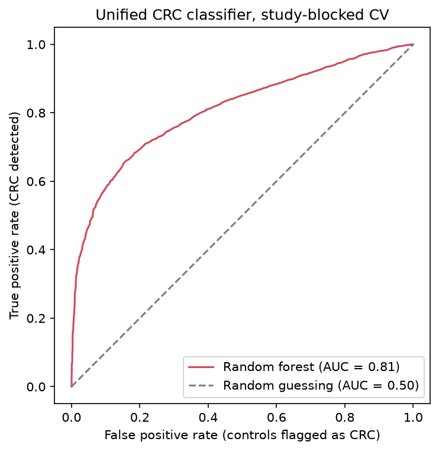
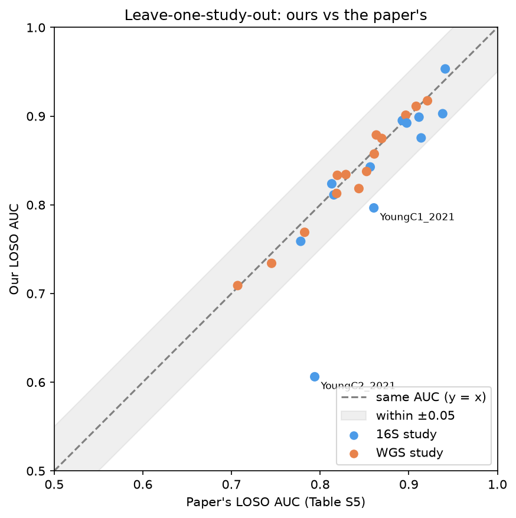

<p align="center">
  <picture>
    <source media="(prefers-color-scheme: dark)" srcset="assets/finki-logo-dark.png">
    
  </picture>
</p>

# Graduation Thesis: Classic ML vs. LLMs for Colorectal Cancer Detection from Gut Microbiome Data

Can a large language model beat classic machine learning at detecting colorectal cancer (CRC) from gut bacteria profiles? This thesis first replicates the random forest classifier from a recent meta-analysis of 27 studies and 5,966 samples ([Pekel, Karcher et al., 2026](https://doi.org/10.1016/j.chom.2026.05.030)) in Python. It then compares tuned classic models and fine-tuned LLMs against that baseline, using the same study-blocked evaluation.

## Phases

| Phase | Goal | Status |
|---|---|---|
| 1 | Rebuild the paper's data preparation from the published profiles | Done |
| 2A | Replicate the paper's random forest and match its AUCs | Done |
| 2B | Tune the random forest and compare other classic models | Planned |
| 3 | Compare with an LLM: zero-shot, few-shot and LoRA fine-tuning | Planned |

## Repository layout

```
assets/          images used by this README
data/raw/zenodo/ input tables from Zenodo (not in git, see Data)
data/processed/  files produced by the notebooks, one folder per notebook (not in git)
notebooks/       one folder per phase, notebooks numbered in run order
results/         figures/ and tables/, each with one folder per notebook
```

## Setup

Requires Python 3.14.

```bash
python -m venv .venv
.venv\Scripts\activate          # Windows
source .venv/bin/activate       # macOS / Linux
pip install -r requirements.txt
python -m ipykernel install --user --name graduation-thesis --display-name "Python (graduation-thesis)"
jupyter lab
```

The notebooks use the `graduation-thesis` kernel, which the `ipykernel` line registers once and which always runs this environment's Python. To run a notebook from the command line, use `python -m nbconvert --to notebook --execute --inplace <notebook>` from the activated environment. Run the notebooks in order, phase by phase.

## Data

The notebooks start from the harmonized genus-level profiles published with the paper on Zenodo, [record 20310630](https://zenodo.org/records/20310630) (CC BY 4.0). Download these two files into `data/raw/zenodo/`:

| File | MD5 |
|---|---|
| `Relab.all.samples.tsv` | `cca9b0b616c721c5655ec1ba8825e260` |
| `Metadata.all.samples.tsv` | `e87644359858f853da198bce3e21b7de` |

The first notebook checks both checksums before doing anything else.

## Results

### Phase 1: data preparation

| Check | Paper | This repository |
|---|---|---|
| Input files | Zenodo record 20310630 | MD5 match for both files |
| Balanced samples (CRC / control) | 5,966 (2,983 / 2,983) | same, balanced inside all 27 studies |
| Genera after the 10% prevalence filter | 347 (Table S3) | same 347, name for name |

Notebooks: [01 data overview](notebooks/phase_1/01_data_overview.ipynb) · [02 balanced subset](notebooks/phase_1/02_balanced_subset.ipynb) · [03 preprocessing](notebooks/phase_1/03_preprocessing.ipynb)

### Phase 2A: random forest replication

Every step follows the paper's Methods: the 347 genera, log10 and standardization learned on the training data only, study-blocked 10×10 cross-validation with the median over repeats, and one model per held-out study for leave-one-study-out. The authors' public R code was used only for details the text leaves open (200 trees, √p features per split, a small floor on each standard deviation).

| Evaluation | Paper | This repository |
|---|---|---|
| Unified model, study-blocked 10×10 CV | 0.84 | **0.808** |
| Leave-one-study-out, 26 studies | mean 0.851 | mean 0.836, mean absolute difference 0.021, 24 of 26 within ±0.05 |
| Cross-validation within each study, 27 studies | mean 0.834 | mean 0.826, mean absolute difference 0.032 |

<p align="center">
  
  
</p>

Notebooks: [01 unified random forest](notebooks/phase_2/phase_2a/01_unified_random_forest.ipynb) · [02 leave-one-study-out](notebooks/phase_2/phase_2a/02_loso_random_forest.ipynb)

Two studies from the same publication are more than 0.05 below the paper in leave-one-study-out: YoungC1_2021 (0.80 against 0.86) and YoungC2_2021 (0.61 against 0.79). Both are reported as unexplained. DuX_2022 has no leave-one-study-out value in Table S5.

## Citation

Pekel, S., Karcher, N., et al. (2026). Meta-analysis reveals microbiome signatures for colorectal cancer that are universal across age groups and sequencing methods. *Cell Host & Microbe*, 34, 1462–1476. https://doi.org/10.1016/j.chom.2026.05.030
